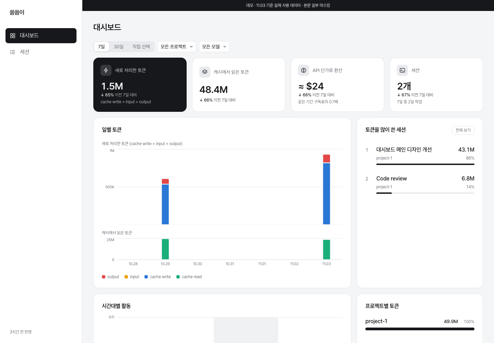
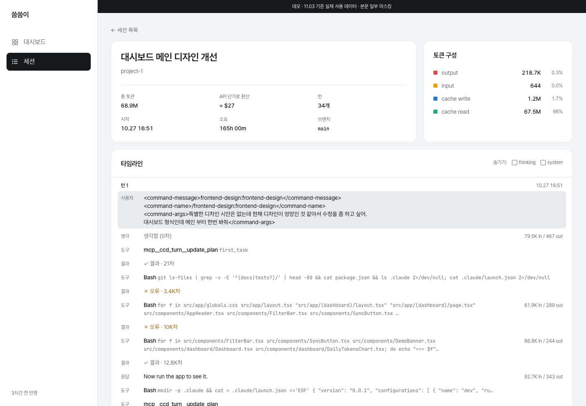

# 씀씀이

Claude Code 토큰 사용량 대시보드 (저장소 이름: tokentrail)

로컬에 쌓인 Claude Code 세션 로그(`~/.claude/projects/**/*.jsonl`)를 읽어 토큰 사용량 대시보드와 세션 타임라인을 보여 주는 개인용 대시보드입니다. 기간·프로젝트·모델별로 토큰이 어디에 쓰였는지 보고, 세션 하나를 열어 턴마다 어떤 도구를 부르고 토큰을 얼마나 썼는지 따라갈 수 있습니다.

**데모:** https://tokentrail-demo.vercel.app/ — 실제 사용 데이터 중 공개해도 되는 개인 프로젝트만 익명화해서 올린 읽기 전용 화면입니다.

| 대시보드                                    | 세션 상세                                         |
| ------------------------------------------- | ------------------------------------------------- |
|  |  |

## 기능

- **대시보드:** 새로 처리한 토큰과 캐시에서 읽은 토큰을 나눈 KPI, API 단가로 환산한 비용과 구독료 대비 배수, 일별 토큰, 토큰을 많이 쓴 세션, 시간대별 활동, 프로젝트·모델별 비중
- **세션 목록:** 기간·프로젝트·모델 필터, 최신순·토큰순 정렬
- **세션 상세:** 토큰 구성, 턴별 타임라인(사용자·응답·도구·결과·생각·시스템), 로컬에서는 원본 JSON 보기

## 로컬 실행

필요한 것: Node.js(개발은 22로 확인), pnpm 10

```bash
pnpm install
cp .env.example .env
```

`.env`의 `DATABASE_URL`을 **절대 경로**로 바꿉니다. Prisma CLI와 앱이 상대 경로를 서로 다른 기준으로 풀어서, 상대 경로를 쓰면 둘이 다른 파일을 보게 됩니다.

```bash
DATABASE_URL="file:/absolute/path/to/tokentrail/data/dashboard.db"
```

```bash
pnpm prisma migrate deploy   # DB 테이블 만들기
pnpm run sync                # 세션 로그 읽어 오기
pnpm dev                     # http://localhost:3000
```

처음 이후에는 화면의 Sync 버튼이나 `pnpm run sync`로 새 로그만 이어서 읽습니다.

## 설정

### `dashboard.config.ts`

| 항목                     | 설명                                                                                              |
| ------------------------ | ------------------------------------------------------------------------------------------------- |
| `timezone`               | 일별 집계와 시각 표시에 쓰는 타임존 (예: `Asia/Seoul`)                                            |
| `subscriptionMonthlyUsd` | 월 구독료. "같은 기간 구독료의 N배" 계산에 쓴다. `SUBSCRIPTION_MONTHLY_USD`가 있으면 그 값이 우선 |
| `autoSyncOnLoad`         | 앱을 처음 열 때 sync를 한 번 실행할지                                                             |
| `pricing`                | 모델 id 접두사별 단가(USD / 1M tokens). 목록에 없는 모델은 "단가 없음"으로 표시하고 비용에서 뺀다 |
| `demo`                   | 데모 allowlist의 기본값. 실제 목록은 아래 `dashboard.demo.json`에 둔다                            |

### 환경 변수 (`.env`)

| 변수                                     | 용도                                      |
| ---------------------------------------- | ----------------------------------------- |
| `DATABASE_URL`                           | 로컬 SQLite 경로 (절대 경로)              |
| `APP_MODE`                               | `local` 또는 `demo`                       |
| `CLAUDE_DIR`                             | 세션 로그 폴더. 비우면 `~/.claude`        |
| `SUBSCRIPTION_MONTHLY_USD`               | 월 구독료 (선택)                          |
| `TURSO_DATABASE_URL`, `TURSO_AUTH_TOKEN` | 데모 DB (`demo` 모드와 `demo:push`에서만) |

## 데모 갱신

데모는 로컬 DB에서 공개할 프로젝트만 골라 익명화한 스냅샷을 Turso에 올리고, Vercel이 `APP_MODE=demo`로 그 DB를 읽는 구조입니다. demo 모드에서는 Sync와 원본 보기가 막혀 있습니다.

1. 공개할 프로젝트를 `dashboard.demo.json`에 적습니다. 경로에 사용자 이름과 폴더 이름이 드러나서 이 파일은 git에 올리지 않습니다(`.gitignore`에 포함).

   ```json
   {
     "projects": ["/Users/me/projects/side-app"],
     "aliases": { "/Users/me/projects/side-app": "side-app" },
     "redactWords": ["acme"]
   }
   ```

   - `projects`: 공개할 프로젝트의 cwd. 비어 있으면 아무것도 내보내지 않습니다.
   - `aliases`: 화면에 보일 이름. 없으면 `project-1`, `project-2`…
   - `redactWords`: 대화 본문에서도 가릴 회사·고객 이름

2. 스냅샷을 만듭니다.

   ```bash
   pnpm run demo:export
   ```

   키·토큰 패턴, 이메일, 홈 경로, 사용자 이름, `redactWords`는 자동으로 가리지만 **JWT, `.env` 형식의 줄, PEM 같은 형식은 가리지 않습니다.** 만들어진 `demo-snapshot.json`을 직접 열어 남은 정보가 없는지 확인합니다.

3. Turso에 올립니다.

   ```bash
   pnpm run demo:push
   ```

   push는 Turso의 테이블을 지운 뒤 다시 채웁니다. 중간에 실패하면 데모가 일부만 채워진 상태로 남으니 다시 실행하면 됩니다.

배포 환경 변수는 `APP_MODE=demo`, `TURSO_DATABASE_URL`, `TURSO_AUTH_TOKEN`(선택: `SUBSCRIPTION_MONTHLY_USD`)입니다. 첫 화면은 빌드 때 미리 렌더링되어 `APP_MODE`와 설정 파일의 `timezone`·`autoSyncOnLoad`가 빌드 시점 값으로 고정됩니다. 이 값을 바꾸면 다시 배포해야 합니다.

데모 데이터는 push한 시점에 멈춰 있어서, demo 모드의 "최근 7일" 같은 기간은 오늘이 아니라 **마지막 API 호출 시각 기준**으로 계산합니다. 화면 위 배너에 기준 날짜가 표시됩니다.

## 개발

```bash
pnpm test        # vitest
pnpm typecheck
pnpm lint
pnpm format:check
```

설계서는 [`docs/specs`](docs/specs/2026-10-12-session-dashboard-design.md), 구현 계획은 [`docs/plans`](docs/plans/2026-10-12-session-dashboard-plan.md)에 있습니다.

## 주의

Claude Code 세션 로그 포맷은 공개된 사양이 아닙니다. Claude Code가 업데이트되면 필드가 바뀌어 일부 줄을 읽지 못할 수 있습니다. 이때 sync는 읽지 못한 줄 수를 "건너뛴 줄"로 알려 줍니다.
