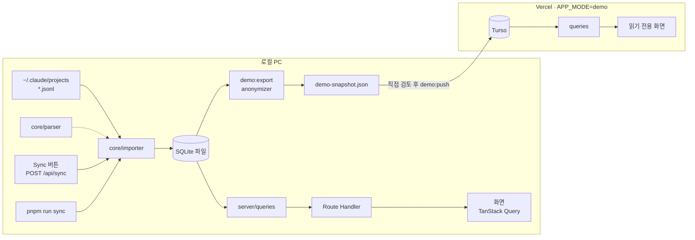
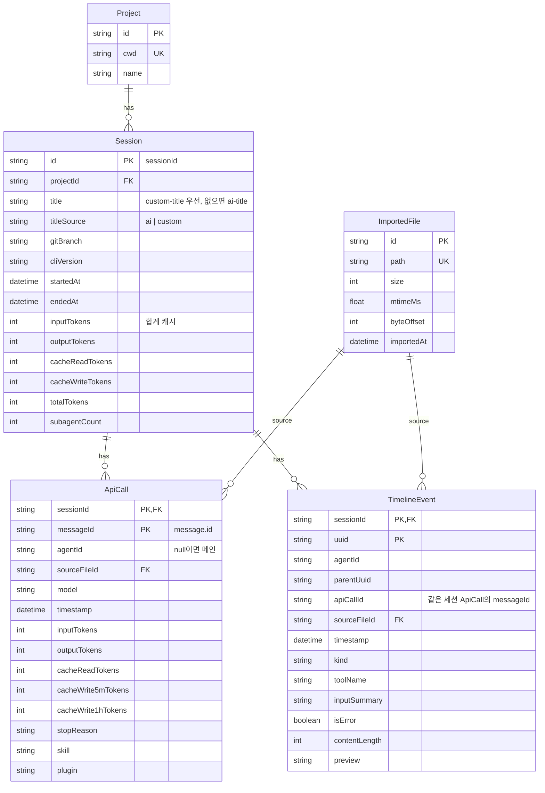
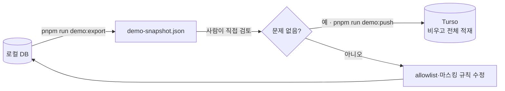

# 세션 분석 대시보드 설계

- 상태: 설계 승인 (2026-10-12), 세션 간 중복 처리·pnpm 전환 반영 (2026-10-15), cache write TTL 분리 (2026-10-16)
- 범위: MVP · 주말 4회
- 원본 아티팩트: https://claude.ai/artifact/9wDtE4U2m15RfTZosxuzC2

로컬 Claude Code 세션 로그(`~/.claude/projects/**/*.jsonl`)를 가져와 토큰 사용량을 보여주고 세션을 다시 따라가 볼 수 있게 하는 개인용 대시보드. 로컬에서 실행하고, 정제한 실제 데이터로 읽기 전용 데모를 공개한다.

## 결정 요약

| 항목 | 결정 | 이유 |
|---|---|---|
| 목적 | 포트폴리오 겸 실사용 | 요청 조건 |
| 스택 | Next.js App Router, TypeScript, TanStack Query, Tailwind, Prisma, Recharts, Vitest | 요청 스택에 차트·테스트 도구만 추가 |
| 실행 방식 | 로컬 실행 + 읽기 전용 데모 배포 | 설치 없는 실사용과 공개 데모 URL을 함께 확보 |
| 사용자 범위 | MVP는 본인만. `npx` 패키징은 이후 | 구조만 배포하기 쉽게 잡아 둠 |
| DB | SQLite 방언 통일. 로컬 SQLite 파일, 데모 Turso(libSQL) | 스키마·SQL 한 벌, 로컬 설치 없음, 0원 |
| 첫 화면 | 토큰 사용량 대시보드. 세션 상세는 타임라인 리플레이 | 매일 볼 실사용 가치 + 포트폴리오에서 보여줄 화면 |
| 비용 표시 | 토큰이 기본 지표. API 환산 비용은 참고값 | 구독 요금제 사용 중이라 실제 청구액이 아님 |
| 구독 한도 화면 | MVP 제외. 집계 쿼리만 시간 구간 지원 | 로그에 한도 값이 없어 정확한 비율을 낼 수 없음 |
| Sync | 수동(버튼·CLI) 기본, 앱 로드 시 자동 sync 옵션 | 단순하고 CLI 진입점을 `npx`에 재사용 |
| 본문 저장 | 종류별 정책. tool_result 본문은 저장 안 함 | DB 경량화, 비밀값 복제 방지 |
| 주간 요약 | MVP 제외. 2단계 회고 기능과 함께 설계 | 회고에 필요한 집계 모양이 아직 정해지지 않음 |
| 데모 본문 | 마스킹한 미리보기 노출 | 리플레이가 실제처럼 보여 포트폴리오 효과가 큼 |
| 세션 간 중복 | 세션별로 저장(복합키). 전체 집계에서만 `messageId` 기준 중복 제거 | 이전 대화가 새 세션 파일로 복사되고, 원본 세션을 판정할 근거가 로그에 없음 |
| cache write 단가 | 5분·1시간 TTL을 나눠 저장하고 단가도 따로 적용. 화면에는 합계로 표시 | 1시간 TTL이 cache write의 약 87%이고 단가가 5분보다 비쌈 |
| 구독료 | 설정 파일 기본값 + `.env`의 `SUBSCRIPTION_MONTHLY_USD`로 컴퓨터별 덮어쓰기 | 회사(Team)·개인(Max) 계정을 주로 다른 컴퓨터에서 씀. 한 컴퓨터에서 두 계정을 쓰면 로그에 계정 구분이 없어 사용량이 합쳐지고 구독료 대비 배수는 대략값이 됨 |

## 범위

**MVP에 포함**

- JSONL 증분 sync (버튼, `pnpm run sync`)
- 대시보드: 기간 필터, KPI, 일별 토큰 차트, 프로젝트·모델별 분포, 상위 세션
- 세션 목록: 필터, 정렬, 커서 페이지네이션
- 세션 상세: 턴 단위 타임라인, 서브에이전트 구분, 원본 보기(로컬)
- 데모용 익명화 export와 Turso push
- Vercel 데모 배포, README

**MVP에서 제외**

- 주간 회고와 LLM 요약 (2단계)
- 구독 한도 화면
- 실시간 파일 감시
- 툴·스킬 활용 패턴 분석
- `npx` 패키징, 다중 사용자, 인증
- sync 동시 실행 잠금, 진행률, 재시도
- UI 자동 테스트(E2E)

## 1. 아키텍처

```
src/
  core/            Next.js에 의존하지 않는 순수 로직 (CLI·npx에서 재사용)
    parser/        JSONL 한 줄 → 내부 표준 이벤트 타입
    importer/      파일 탐색, 증분 판별, DB 저장
    anonymizer/    데모용 마스킹 export
    pricing/       모델별 단가표, API 환산 비용 계산
  server/
    db.ts          Prisma client (APP_MODE에 따라 SQLite 파일 / Turso)
    queries/       집계 쿼리 (기간·프로젝트·모델, 시간 구간 파라미터)
  app/
    api/           조회 Route Handler, POST /api/sync
    (dashboard)/   화면
scripts/
  sync.ts          CLI 진입점
  demo-export.ts   익명화 스냅샷 생성
  demo-push.ts     스냅샷을 Turso에 적재
```

- **parser가 로그 포맷 변화를 흡수하는 유일한 곳.** 로그 포맷은 공식 공개 스펙이 아니다. 상위 계층은 내부 표준 타입만 안다.
- **core는 Next.js를 import하지 않는다.** 버튼, CLI, 이후 `npx`가 같은 코드를 쓴다.
- **모드는 `APP_MODE=local|demo` 하나로 나눈다.** demo는 sync 비활성, DB를 Turso로 연결.
- **조회는 클라이언트 TanStack Query로 통일.** 필터는 URL 쿼리 파라미터에 두고 queryKey에 그대로 쓴다. sync 후 전체 invalidate.



## 2. 데이터 모델

실제 로그의 키 구조를 확인한 결과(본문 미열람) 설계에 반영한 사실:

- 세션 로그는 `<project>/<sessionId>.jsonl`, 서브에이전트는 `<sessionId>/subagents/agent-*.jsonl`로 따로 기록된다.
- 줄 타입이 많다(`user`, `assistant`, `system`, `attachment`, `ai-title`, `file-history-snapshot` 등). 필요한 것만 쓰고 나머지는 무시한다.
- 토큰은 `assistant` 줄의 `message.usage`(`input_tokens`, `output_tokens`, `cache_read_input_tokens`, `cache_creation_input_tokens`)와 `message.model`에 있다.
- cache write는 `message.usage.cache_creation`에 TTL별(`ephemeral_5m_input_tokens`, `ephemeral_1h_input_tokens`)로도 기록된다(2026-10-15 확인: 1시간이 약 87%). 단가가 달라 `ApiCall`에 따로 저장하고, 세션 합계와 화면의 cache write는 둘의 합이다. `cache_creation`이 없으면 전부 5분으로 본다.
- 한 API 응답이 블록 단위(`apiBlockIndex`)로 여러 줄에 나뉘는 것으로 보인다. **`message.id`로 중복 제거하지 않으면 토큰이 여러 번 집계된다.**
- 프로젝트는 폴더 이름이 아니라 각 줄의 `cwd`로 식별한다. `gitBranch`, `attributionSkill`, `attributionPlugin`도 있다.
- **이전 대화가 다른 세션 파일로 복사된다.** 같은 `message.id`와 `uuid`가 서로 다른 세션 파일 2~7개에 나온다(2026-10-15 확인: assistant `message.id` 16,367개 중 4,876개, user·assistant `uuid` 49,463개 중 14,555개). 복사본은 `sessionId`만 새 세션 값이고 `timestamp`는 원본과 같다. `forkedFrom`이 붙은 경우는 일부(172건)뿐이라 어느 세션이 원본인지 판정할 수 없다.



### 세션 간 중복 처리

- **저장:** `ApiCall`은 `(sessionId, messageId)`, `TimelineEvent`는 `(sessionId, uuid)`가 기본키다. 각 세션 파일 내용을 그대로 저장하므로 resume한 세션을 열어도 앞부분 대화가 보인다.
- **전체 집계**(KPI 총 토큰·API 환산, 일별 차트, 프로젝트·모델별 분포): `messageId` 기준으로 중복을 제거한다. 대표 행은 `sessionId` 사전순 첫 행이며 프로젝트 귀속에만 영향이 있다.
- **세션 단위**(세션 합계 캐시, 세션 목록, 세션 상세, 상위 세션): 그 세션 파일에 기록된 호출 전부를 센다. 복사된 호출이 포함되므로 세션 합계를 모두 더하면 전체 총합보다 클 수 있다.
- 프로젝트로 거를 때도 대표 행은 전체 기준으로 고른 뒤 대표 행의 프로젝트로 거른다. 그래서 프로젝트 필터 화면의 합계와 전체 화면의 프로젝트 막대가 같다.
- 이어받은 호출을 구분해 표시하는 기능은 원본 판정 근거가 없어 2단계로 미룬다.

### 이벤트 종류별 저장 정책

| kind | 저장하는 것 | 저장하지 않는 것 |
|---|---|---|
| `user` | 미리보기(앞 500자) | 나머지 본문 |
| `assistant_text` | 미리보기(앞 500자) | 나머지 본문 |
| `tool_use` | 툴 이름, 입력 요약 한 줄(명령어, 파일 경로, 검색어) | 전체 입력 객체 |
| `tool_result` | 성공·에러 여부, 결과 크기 | 본문 전체 |
| `thinking` | 존재 여부, 길이 | 본문 전체 |
| `system` | 훅 이름, 에러 여부 | 본문 |

전체 본문이 필요하면 로컬 모드에서만 "원본 보기"로 JSONL의 해당 줄을 직접 읽어 보여준다. DB에는 남기지 않는다.

## 3. Sync 흐름

스캔 대상은 `$CLAUDE_DIR/projects/**/*.jsonl`(서브에이전트 포함). `CLAUDE_DIR` 기본값은 `~/.claude`.

| 파일 상태 (ImportedFile 대비) | 처리 |
|---|---|
| 처음 보는 파일 | offset 0부터 읽는다 |
| 크기 > byteOffset | offset 이후만 읽는다 (진행 중인 세션 포함) |
| 크기 = byteOffset | 건너뛴다 |
| 크기 < byteOffset | 해당 `sourceFileId`의 데이터를 지우고 처음부터 다시 읽는다 |

- 마지막 줄에 개행이 없으면(쓰는 중) 마지막 개행까지만 처리하고 그 위치를 `byteOffset`으로 저장한다.
- parser는 모르는 타입을 무시하고, 깨진 줄은 건너뛰며 개수를 센다.
- 파일 하나 = 트랜잭션 하나. `ApiCall`은 `(sessionId, messageId)`, `TimelineEvent`는 `(sessionId, uuid)` 기준 upsert. 다른 세션 파일의 복사본과 키가 겹치지 않아, 파일 하나를 지우고 다시 읽어도 다른 세션 데이터에 영향이 없다.
- 파일 처리 후 해당 세션의 토큰 합계 캐시를 다시 계산한다.
- 반환값: 읽은 파일 수, 새 이벤트 수, 건너뛴 줄 수. 버튼은 토스트로, CLI는 콘솔로 출력한다.
- 자동 sync 옵션은 앱 첫 로드 시 한 번만 실행한다. demo 모드에서 `POST /api/sync`는 403.

## 4. 화면

화면은 세 개. 프로젝트별 화면과 설정 화면은 두지 않고 필터와 설정 파일로 대신한다. 와이어프레임은 원본 아티팩트 참고.

### 대시보드 `/`

SaaS 대시보드 틀(2026-10-29): 넓은 화면은 왼쪽 사이드바(대시보드·세션 메뉴, 아래쪽에 마지막 sync 시각과 Sync 버튼)와 본문 위 페이지 제목. 좁은 화면은 상단 바 한 줄. 섹션은 모두 카드.

- 필터 줄: 기간 세그먼트(7일 / 30일 / 직접 선택), 프로젝트·모델 선택
- KPI 카드 4장: 새로 처리한 토큰(cache write + input + output), 캐시에서 읽은 토큰, API 환산(≈ $, 구독료 대비 배수), 세션 수(활동일 예: 17 / 30). 카드마다 직전 같은 길이 기간 대비 증감. cache read가 대부분이라 총 토큰 하나로는 실제 처리량이 보이지 않아 둘로 나눈다.
- 일별 토큰(2/3): 같은 날짜 축을 쓰는 두 차트. 위는 신규 처리 3종(cache write, input, output) 누적, 아래는 cache read. 한 막대에 4종을 쌓으면 cache read에 가려 나머지가 보이지 않는다.
- 토큰을 많이 쓴 세션 TOP 5(1/3) → 클릭 시 세션 상세. 순위, 기간 전체 대비 비율, 1위 대비 막대.
- 시간대별 활동(2/3, 2026-10-27 추가): "날짜 × 24시간" 칸을 API 호출 수로 칠한다. 세션 시작 시각이 아니라 실제 호출 시각 기준이라 며칠에 걸쳐 이어 쓴 세션도 활동한 시간대마다 찍힌다. 칸 hover 시 호출 수, 토큰, 그 칸에서 토큰을 가장 많이 쓴 세션을 보여준다. 데이터는 `Overview.activity`로 함께 내려 기간·필터·`messageId` 중복 제거가 다른 지표와 같다(계획서 Task 9a).
- 프로젝트별 토큰 TOP N과 모델별 비율(1/3, 한 카드): 가로 막대, 기간 전체 대비 비율.
- 최근 세션 5행 표 → "전체 보기"로 세션 목록.
- 색: 화면 틀은 무채색, 색은 토큰 4종에만 쓴다. 색 값과 배정 이유는 계획서 Task 9 구현 메모 참고.

### 세션 목록 `/sessions`

- 컬럼: 제목(custom-title 우선, 없으면 ai-title), 프로젝트, 브랜치, 시작 시각, 소요 시간, 토큰, 서브에이전트 수
- 필터: 프로젝트, 기간, 모델. 정렬: 최신순, 토큰순
- 커서 페이지네이션. 필터 변경 중에는 이전 결과를 유지해 깜빡임을 막는다.

### 세션 상세 `/sessions/[id]`

- 헤더: 제목 · 프로젝트 · 브랜치 · 소요 시간 · 총 토큰 · ≈ $. 숨기기 토글(thinking, system)
- 타임라인 행 종류: USR(사용자 프롬프트, 강조), AST(응답 미리보기 + 토큰 배지), TOOL(툴 이름 + 입력 요약, ✓/✗와 결과 크기), THK(생각함, 길이), SUB(서브에이전트, 들여쓰기)
- 턴 단위로 묶는다: 사용자 프롬프트 하나와 그 뒤의 작업들.
- API 호출마다 토큰 배지. 이벤트마다 "원본 보기"(로컬 모드만).

### 공통

- demo 모드에서는 "demo 모드 배너 · 실제 사용 데이터 · 본문 일부 마스킹" 배너를 띄우고 Sync 버튼을 숨긴다.
- 데이터가 없으면 Sync 실행과 CLI 명령어를 안내한다.
- 단가표, 구독료, 자동 sync 여부, 데모 allowlist와 별칭은 설정 파일 하나에 둔다. 구독료만 컴퓨터별로 `.env`에서 덮어쓸 수 있다.

## 5. 데모 익명화와 배포



| 대상 | 규칙 |
|---|---|
| 포함 범위 | 설정의 `demo.projects` allowlist에 있는 프로젝트만. 기본값은 빈 목록이라 지정하지 않으면 아무것도 나가지 않는다. |
| 프로젝트 이름 | `cwd`를 설정한 별칭으로 바꾼다 (예: `side-project-a`). |
| 미리보기, 입력 요약 | 키·토큰 패턴(`sk-…`, `ghp_…`, `Bearer …`)과 이메일을 `[REDACTED]`로, 홈 경로와 사용자 이름을 `~`로, 절대 경로를 프로젝트 기준 상대 경로로 바꾼다. |
| 숫자 데이터 | 토큰, 시간, 모델, 툴 이름, 에러 여부는 그대로 둔다. |
| 로컬 전용 필드 | 원본 JSONL 경로 등은 제거한다. |

Vercel 환경변수: `APP_MODE=demo`, `TURSO_DATABASE_URL`, `TURSO_AUTH_TOKEN`. `demo:push`는 로컬에서 실행하고 Turso 토큰은 로컬 `.env`에만 둔다.

## 6. 테스트와 일정

버그가 나면 숫자가 조용히 틀어지는 `core`를 TDD로 진행한다 (Vitest). 실제 로그 구조를 본뜬 작은 JSONL fixture를 직접 만들어 쓰고, 실제 로그 원본은 커밋하지 않는다.

| 대상 | 확인할 것 |
|---|---|
| parser | 같은 `message.id`가 여러 줄이어도 토큰 1회 집계 · 모르는 타입·깨진 줄 건너뛰고 개수 집계 · 서브에이전트 파일에 `agentId` 부여 · tool_result 본문 폐기, 크기·에러만 유지 |
| importer | 처음 import · 이어 읽기 · 크기 줄어든 파일 재import · 미완성 마지막 줄 offset 처리 · 같은 sync 두 번 실행 시 결과 동일 · 다른 세션 파일에 같은 `message.id`·`uuid`가 있어도 세션마다 저장되고 한쪽 재import가 다른 쪽을 지우지 않음 (임시 SQLite 파일 사용) |
| anonymizer | 빈 allowlist면 export 없음 · 키·이메일·경로 마스킹 · 숫자 데이터 보존 |
| queries | 기간·프로젝트·모델 집계를 fixture DB로 검증 · 세션 간 복사된 호출은 전체 집계에서 1회만 |
| UI | MVP는 직접 확인. E2E 없음 |

| 주차 | 내용 | 완료 기준 |
|---|---|---|
| WEEK 1 | 프로젝트 세팅, Prisma 스키마, parser·importer(TDD), `pnpm run sync` | CLI로 내 로그 전체 import |
| WEEK 2 | 집계 queries, 대시보드 화면, Sync 버튼 | 대시보드에서 실제 사용량 확인 |
| WEEK 3 | 세션 목록, 세션 상세 타임라인, 원본 보기 | 아무 세션이나 열어 흐름을 따라갈 수 있음 |
| WEEK 4 | anonymizer, Turso 연동, Vercel 데모 배포, README | 공개 데모 URL 동작 |

일정이 밀리면 원본 보기 → 모델별 비율 차트 → 세션 목록 정렬·필터 일부 순서로 뺀다. 데모 배포는 포트폴리오 목표라 끝까지 유지한다.

## 구현 전 확인 필요

- **Prisma + Turso 연동 (확인됨).** `@prisma/adapter-libsql`로 로컬 `file:`과 Turso를 같은 코드로 연결한다. Turso에는 Prisma Migrate를 직접 쓰지 않고, 마이그레이션 SQL을 `@libsql/client`로 적용한다. 무료 티어 조건은 가입 시 확인한다.
- **중복 줄의 usage 값 (확인됨).** 같은 `message.id`를 가진 줄 1,955쌍의 usage가 모두 동일했다. 먼저 들어온 값을 쓴다.
- **로그 포맷 변경.** 비공식 포맷이라 Claude Code 업데이트로 바뀔 수 있다. 영향 범위는 parser로 한정한다.

## 2단계 이후

- **주간 회고**: 주간 통계와 git 커밋을 묶어 LLM으로 요약. provider 교체 가능(Anthropic API 종량제 또는 로컬 모델), LLM 없을 땐 통계 카드만.
- **구독 한도 화면**: 최근 N시간·이번 주 사용량, 직접 입력한 한도 대비 대략적 비율.
- **툴·스킬 활용 패턴**: `attributionSkill`, 툴 에러율, 서브에이전트 사용 빈도.
- **이어받은 호출 구분**: 세션 상세에서 이전 세션에서 복사된 호출을 따로 표시. 원본 세션 판정 규칙을 먼저 찾아야 한다(`forkedFrom` 등).
- **실시간 sync**: 파일 감시로 진행 중인 세션 반영.
- **`npx` 패키징**: CLI 진입점 재사용, 다른 사람이 자기 PC에서 실행.
- **한 컴퓨터에서 여러 계정 구분**: 계정별 Claude 설정 폴더를 나누거나 프로필(로그 폴더 + 구독료)을 두고 화면에서 선택. 지금은 로그에 계정 정보가 없어 한 컴퓨터의 두 계정 사용량이 합쳐진다.
